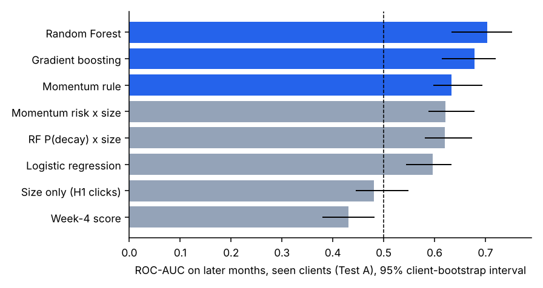
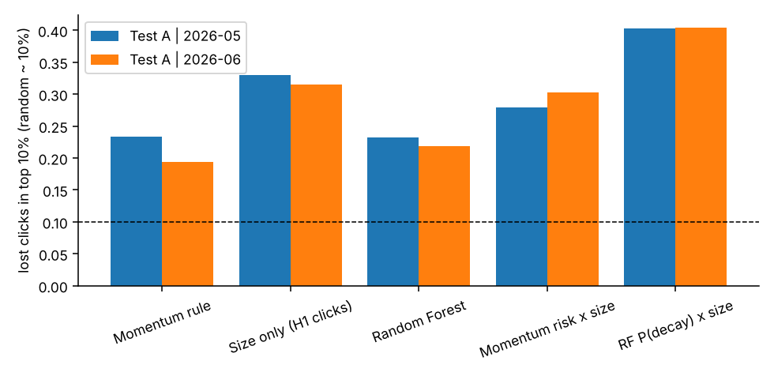
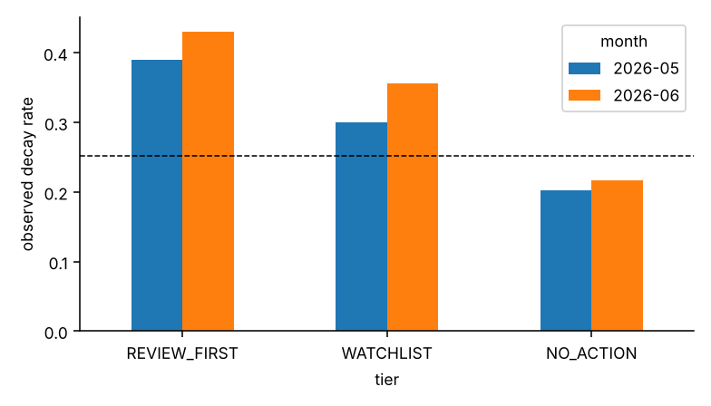

# Content Decay Forecasting: which pages lose clicks next?

A time-forward test of a content-refresh queue on six months of real (pseudonymized) Google Search Console data. Built during the FlyRank ML internship, Refresh / Content Opportunity Scoring lane.

**Paper:** [aidib-portfolio.vercel.app/paper](https://aidib-portfolio.vercel.app/paper/) · **Full write-up:** [`work/capstone_report.md`](work/capstone_report.md) · **Numbers:** [`work/outputs/capstone_results.json`](work/outputs/capstone_results.json)

> Decision-support, not an autopilot. Everything here is observed and directional. Nothing in this repo shows that refreshing a page recovers clicks.

## Question

Using only days 1-15 of a month, which pages will lose clicks in days 16-end, beyond what the typical page loses that month?

## Results



| Finding | Evidence |
|---|---|
| A Random Forest beats a one-line rule on seen clients | ROC-AUC **0.704** vs **0.633** for the click-momentum rule on 19 clients and 1,870 pages (difference +0.071, 95% client-bootstrap interval +0.015 to +0.092) |
| It does not clearly generalize to unseen clients | On 6 unseen clients: 0.714 vs 0.702. The interval is too wide to read, so the result is **inconclusive** |
| The older Week-4 opportunity score is not a risk ranker | ROC-AUC **0.431** (0.379-0.482), below chance. Pages it rates as high-opportunity decayed *less* than typical |
| Size alone explains a lot of "clicks captured" | The top 10% largest pages hold 31-33% of lost clicks. The queue (P(decay) x clicks) holds ~40%, so it adds roughly 7-9 points on top of size |
| The queue is a place to look first, not a safety net | 35-38% of lost clicks sit in the NO_ACTION tier |

Sensitivity: the Random Forest minus momentum gap on seen clients is +0.070 / +0.071 / +0.055 at 20 / 50 / 100-click floors, and +0.062 / +0.063 / +0.043 with the raw (unadjusted) label.



## Design

- **Data:** daily page performance, January-June 2026. 22,928 page-months with at least 20 clicks in days 1-15; the main analysis uses the 5,830 above a 50-click floor.
- **Features (days 1-15 only):** `impr_h1`, `ctr_h1`, `pos_h1`, `click_momentum`, `impr_momentum`, `pos_slip`.
- **Label (days 16-end only):** a page decays when its clicks/day fall below 80% of the typical page's ratio in the same month. A raw threshold would mistake June's market-wide second-half fall (median ratio 0.760, raw decay rate 0.566) for page decay; the adjusted label brings it to 0.288.
- **Split:** train January-April (20 clients, 3,027 pages). **Test A:** May-June, clients seen in training (19 clients, 1,870 pages). **Test B:** May-June, clients never seen in training (6 clients, 433 pages).
- **Baselines:** click-momentum rule, size only (clicks in days 1-15), Week-4 opportunity score.
- **Uncertainty:** client-cluster bootstrap, 200 draws, seed 42.

## How leakage was handled

1. **The first model was invalid, and the repo says so.** W05 v1 scored ROC-AUC 1.0000 because the label was a SQL rule over the model's own features. The audit is in [`work/outputs/w05_audit_report.md`](work/outputs/w05_audit_report.md).
2. **Strict windows.** Features from days 1-15, label from days 16-end, with an assertion that no label-window column is in the feature list.
3. **Shuffled-label control:** ROC-AUC 0.506 (expected ~0.5).
4. **Deliberate-leak controls:** adding the label-window ratio as a feature lifts Test A from 0.704 to 0.946; adding the label's own quantity gives 1.000. The harness can detect a leak.
5. **Disclosed selection effect:** a page is kept only with at least 7 days of data in both halves of the month. That removed 210 of 22,928 rows (0.9%), and the label uses the month's median ratio, so it can only be computed after the month ends.
6. **Disclosed design choices:** the 50-click floor and the lean feature set came from the single-month W05 analysis, so May is the cleaner test month. No sealed-holdout claim is made.

## Playbook (decision-support)

Reason codes were kept only if flagged pages decayed more than unflagged ones on Test A.

| Reason code | Flagged vs unflagged decay rate | Risk ratio | Verdict |
|---|---|---|---|
| `IMPRESSIONS_FALLING` | 0.445 vs 0.185 | 2.41 | Keep |
| `CLICKS_FALLING` | 0.378 vs 0.189 | 2.00 | Keep |
| `POSITION_SLIPPING` | 0.330 vs 0.204 | 1.62 | Keep |
| `LOW_CTR_FOR_POSITION` | 0.214 vs 0.264 | 0.81 | **Dropped**: flagged pages decayed *less* |
| `HIGH_VOLUME` | 0.238 vs 0.254 | 0.94 | Dropped as a risk code; kept as a senior-review-before-editing flag |



**Tiers (Test A, observed):** REVIEW_FIRST (top 10%) decayed at 0.39 (May) and 0.43 (June) against base rates of 0.24 and 0.27, and holds ~40% of lost clicks. WATCHLIST: 0.30 and 0.36. NO_ACTION: 0.20 and 0.22.

**Queue on the June 2026 sample panel** ([`w07_action_playbook.ipynb`](work/notebooks/w07_action_playbook.ipynb)): 4,547 pages, split into 454 REVIEW_FIRST, 910 WATCHLIST and 3,183 NO_ACTION. Of the REVIEW_FIRST pages, 218 are `HIGH_VOLUME` and 68 are `HIGH_VOLUME` with no falling or slipping code, meaning big pages to read before acting.

**Human-in-the-loop (suggested team policy, not validated):** senior review before editing `HIGH_VOLUME` pages; reviewers read the reason codes and treat a page with no falling code as "big, not necessarily at risk". Landing pages, homepages and legal pages are on a no-go list for automation.

**Monitoring:** track the monthly median page ratio, the adjusted decay rate, whether REVIEW_FIRST still decays above the base rate, and each code's risk ratio. Drop a code whose ratio falls to 1 or below.

## Limitations

- Observational data, no recorded refresh events: no causal claim.
- 19 seen and 6 unseen clients, six months, 15-day windows and a proxy label.
- The Random Forest's edge over the momentum rule is modest and not separable on unseen clients.
- The queue's size term pulls large, stable pages to the top (in the May top 10, 4 of 10 pages decayed).

## Repository map

```
work/
  capstone_report.md      full write-up (numbers trace to capstone_results.json)
  notebooks/              w01 ... w07 assignments + capstone.ipynb
  archive/                two optional, unexecuted stretch notebooks
  outputs/                capstone_results.json, w05_audit_report.md
  figures/                fig1-fig4 used above
scripts/                  FlyRank's reference pipeline (unchanged baseline)
docs/STARTER_README.md    FlyRank's original starter instructions
data/raw/                 FlyRank's anonymized starter slice (see DATA_USE.md)
submission/paper_url.txt  deployed paper
```

## Reproducing

- **Reference pipeline on the bundled slice** (no credentials): `pip install -r requirements.txt && python scripts/run_all.py`. This is FlyRank's starter pipeline, not the capstone analysis.
- **Capstone analysis:** open [`work/notebooks/capstone.ipynb`](work/notebooks/capstone.ipynb) in Colab, add a Colab secret `HF_TOKEN` (read token), then Run all. It reads the full release from `FlyRank/internship-warehouse` on Hugging Face, which is **gated**: access must be approved first. Seed 42 throughout.
- Versions of the saved run: pandas 2.2.3, scikit-learn 1.6.1, DuckDB 1.3.2.

## Data and privacy

Only hashed, pseudonymous ids are used, for grouping and joining, never as features. No client names, domains, URLs or queries appear anywhere in `work/`. The only dataset in the repo is the anonymized starter slice FlyRank ships, governed by [`DATA_USE.md`](DATA_USE.md); CI fails any other committed dataset.

## Credits

Built on the [FlyRank](https://flyrank.ai) ML Internship dataset and starter repo. Code is MIT-licensed; the data is governed separately by `DATA_USE.md`.
